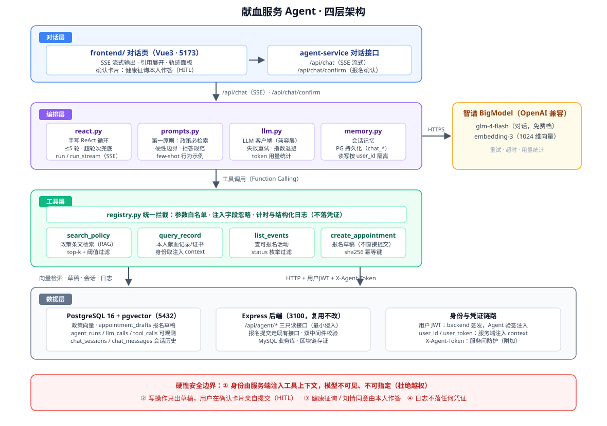

# 献血服务 Agent（agent-service）

在已有的「区块链献血存证系统」之上新增的自然语言服务层，面向**献血者本人（donor）**提供政策咨询、个人记录查询、活动查询与报名引导。

- 只聊献血：不做通用聊天，非献血话题礼貌拒绝并引导回血站主题
- 有据可依：政策问题一律先检索政策原文（RAG）再作答，标注出处，检索不到明确说"没有找到相关依据"
- 身份安全：用户身份由服务端从 JWT 注入，**不作为模型可见的工具参数**，从根上杜绝越权查询他人数据
- 不做医疗结论：涉及个人身体状况一律引导至血站现场核查 / 医生判断
- 写操作人审：报名只生成草稿，健康征询与知情同意由用户本人在确认卡片中亲自作答后才提交

> **关于本仓库**：这是毕业设计系统的 AI 服务层（Agent 侧），业务系统（Express + MySQL + Solidity 存证合约）代码不在本仓库。
> 设置 `USE_MOCK_BIZ=true` 即可脱离业务系统独立运行，用于本地演示与评测链路验证。

## 一、架构（四层）



（下图为等价的文字版，便于终端查看）

```
┌─────────────────────────────────────────────────────────────┐
│ 对话层   frontend/ 对话页（Vue3）  ──SSE──►  agent-service   │
│            /api/chat（流式）  /api/chat/confirm（报名确认）   │
├─────────────────────────────────────────────────────────────┤
│ 编排层   app/agent/                                        │
│            react.py     手写 ReAct 循环（≤5 轮，含流式）      │
│            prompts.py   角色/边界/第一原则（政策必检索）      │
│            memory.py    会话短期记忆                         │
│            llm.py       OpenAI 兼容客户端（重试/超时/用量）   │
├─────────────────────────────────────────────────────────────┤
│ 工具层   app/tools/                                        │
│            search_policy        政策条文检索（RAG）           │
│            query_record         查本人献血记录/证书           │
│            list_events          查可报名活动                  │
│            create_appointment   生成报名草稿（不直接提交）     │
│            registry.py          注册表：参数白名单、注入字段、 │
│                                 统一计时与日志（不记凭证）     │
├─────────────────────────────────────────────────────────────┤
│ 数据层   PostgreSQL+pgvector（政策向量、运行日志、报名草稿）  │
│          现有 Express 系统 HTTP 接口（个人资料/记录/活动）    │
└─────────────────────────────────────────────────────────────┘
```

## 二、与现有系统的关系

本服务是**叠加的 AI 服务层**，不改动现有业务：

- **不直连 MySQL**：业务数据一律通过 HTTP 调现有 Express 后端（`BIZ_API_BASE`，默认 `http://localhost:3100`）
- **不碰区块链**：链上验真复用后端已有接口的结果，不新增链上对象
- **不改表结构**：预约不新建库表，报名草稿只落在 Agent 侧 PG 的 `appointment_drafts`，确认提交时仍走后端既有报名接口
- **最小侵入**：业务后端仅新增 1 个内部路由文件 + 1 行挂载，业务代码零改动

## 三、对接约定

| 约定 | 说明 |
|---|---|
| 端口 | Agent 服务 `8000`；现有后端 `3100`；前端 `5173`（已配置 `/agent-api` 代理到 8000） |
| 用户鉴权 | 复用现有 JWT：`/api/chat` 校验前端带来的 Bearer token，`JWT_SECRET` 与业务后端一致 |
| 服务间防护 | Agent → 业务后端内部接口携带 `X-Agent-Token`，与业务后端的 `AGENT_SERVICE_TOKEN` 一致 |
| 身份注入 | `user_id` / `user_token` 由服务端注入工具上下文，模型看不到也无法指定；工具 Schema 无身份参数 |
| 内部接口 | backend 侧 `/api/agent/*` 三只读接口（profile / records / certificate），身份一律取 `req.user.id` |

> **关于 `JWT_SECRET` 双端共享的安全边界**：当前是单机内网信任模型——Agent 侧验签只用于**只读**工具的身份注入；
> 唯一写操作（报名确认）携带用户原始 JWT 转发 backend，由 backend 的 `authenticateToken` + `X-Agent-Token`
> 双中间件强校验，Agent 无任何提权能力。若演进为多服务/生产部署，标准方向是：Agent 改持**短时专用 token**
> （独立 audience），或对接 OAuth 2.0 Token Introspection（RFC 7662）由授权服务器在线校验，Agent 不再持有验签密钥。

## 四、快速开始

前置：Docker（起 PG）、Python 3.11。业务系统与前端为可选依赖——`USE_MOCK_BIZ=true` 时无需业务系统即可跑通对话与评测。

```bash
# 0) （可选）业务系统：MySQL + Express 后端，联调真实数据时需要
#    未启动时保持 .env 中 USE_MOCK_BIZ=true 即可独立运行

# 1) Agent 侧 PostgreSQL（pgvector）
docker compose up -d                 # 5432, blood_agent

# 2) Python 环境
python -m venv .venv
.venv/Scripts/pip install -r requirements.txt
cp .env.example .env                 # 填 LLM_API_KEY；mock 模式下 JWT_SECRET / AGENT_SERVICE_TOKEN 可留空

# 3) 建表 + 灌政策文档
.venv/Scripts/python.exe scripts/init_db.py
.venv/Scripts/python.exe scripts/ingest_policy.py

# 4) 启动 Agent 服务（一键脚本，等价于下一行的手动命令）
.\start.bat
# .venv/Scripts/python.exe -m uvicorn app.main:app --port 8000

# 5) （可选）前端对话页
#    mock 模式下可直接调 /api/chat 验证；接入自己的前端时把接口指向 8000 即可
```

## 五、环境变量

见 [.env.example](.env.example)。关键项：

| 变量 | 说明 |
|---|---|
| `LLM_BASE_URL` / `LLM_MODEL` | OpenAI 兼容协议，可切换平台。当前用智谱免费档 `glm-4-flash` |
| `EMBEDDING_MODEL` / `EMBEDDING_DIM` | `embedding-3` / 1024 维，与 `policy_chunks.embedding` 维度一致 |
| `JWT_SECRET` | **必须与业务后端一致**，用于校验用户登录态 |
| `AGENT_SERVICE_TOKEN` | 服务间调用凭证，与业务后端一致 |
| `USE_MOCK_BIZ` | 后端不可用时可置 true 用 mock 业务数据开发；联调/评测必须为 false |
| `USE_FAKE_EMBEDDING` | 仅 Embedding 配额不可用时临时验证工程链路；正式保持 false |
| `RETRIEVAL_SCORE_THRESHOLD` | 检索最低相似度。智谱 embedding-3 实测取 0.5（相关块 >0.6，噪声 <0.45） |

## 六、评测

```bash
# 需 8000 与 3100 在线；评测身份 it009（donor）
.venv/Scripts/python.exe scripts/run_eval.py
```

- 用例集：[data/eval_cases.json](data/eval_cases.json) 共 **48 条**：政策问答 18 / 记录查询 10 / 活动报名 5 / 越界拒答 5 / 医疗引导 5 / 越权 3 / 系统介绍 2
- 判定方式：**全确定性规则**（工具调用比对、引用文档名命中、关键词匹配、HTTP 状态码），不使用 LLM 当裁判，可复现
- 报告产出：`docs/eval_report.md`

### 评测结果（业务范围修正后回归版）

| 维度 | 结果 |
|---|---|
| 工具选择（政策 18 / 记录 10 / 活动 5） | 33/33（100%） |
| 工具选择-系统介绍 | 2/2（100%） |
| 检索命中率（引用文档命中） | 18/18（100%，扩容文档 6/6 覆盖） |
| 拒答准确率（零工具 + 引导回血站主题） | 5/5（100%） |
| 医疗引导合规率（检索 + 引导语，不下结论） | 5/5（100%） |
| 越权拦截率 | **数据层 3/3（100%）**；话术层 2/3（auth-03 已知残留） |
| **整体通过率** | **47-48 / 48（97.9%-100%）** |

- 稳定性：48 条用例全量回归，**除 auth-03 外 47 项全过**；历史三轮（45 条口径）同样仅 auth-03 间歇抖动
- 业务范围修正：系统不涉及「用血报销」，已删除对应政策文档与 3 条用例，并补入 6 条覆盖扩容文档《献血前准备与暂缓情形》的用例（45 → 48 条）
- 平均耗时约 6.3-7.3s/条；单轮 Token 约 20-24.6 万（glm-4-flash 免费档，成本 ¥0）
- 迭代：33 → 38 → 41 → 42（43 条）→ 扩容 45 条暴露系统类盲区回落 40 → 43 → events-05 修复 → auth-03 字符级禁令 → 三轮 44-45/45 → 业务范围修正 47/48（修复全部落在 prompt 层与知识库数据，工具逻辑零改动）
- 残留说明：**auth-03** 话术层偶发复述用户消息里的他人用户名（数据层隔离始终生效，从未泄露他人数据），属免费小模型指令遵循边界，归因与演进路径详见 [eval_report.md](docs/eval_report.md)

## 七、可观测

每次对话落三张表（Agent 侧 PG）：`agent_runs`（一次对话汇总：状态/token/成本/耗时）、`llm_calls`（每轮 LLM 明细）、`tool_calls`（每次工具调用：模型侧参数/耗时/成败）。**日志只记录模型侧参数，绝不记录注入的 user_token / user_id**，避免凭证泄漏。

## 八、已知限制

- 不做医疗诊断、不下医疗结论；健康征询五项与知情同意必须由用户本人作答，AI 不代答不代交
- 只服务 donor 一个角色，不支持管理员/血站/医院/学校业务操作
- 政策库当前为 4 篇文档（8 个切片：3 篇政策示例 + 1 篇《平台介绍与角色说明》），正式使用需将政策示例替换为真实政策文件并重灌
- 演示原型：会话历史已持久化到 PG（chat_sessions / chat_messages），但轨迹/引用/确认卡片仅当次运行内可见；未做多实例水平扩展
- `JWT_SECRET` 与 backend 双端共享（单机内网信任模型）：Agent 侧验签仅用于只读工具的身份注入，唯一写操作由 backend 双中间件强校验；多服务/生产部署应演进为短时专用 token 或 RFC 7662 token introspection（详见第三节）
- glm-4-flash 为免费小模型，同一问题存在轮次间抖动，评测结论以**区间（47-48/48）**为准，不承诺逐轮 100%
